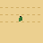
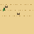
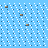
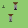
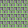
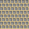
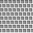

# BattleBlitz · 战棋

> 当前状态（2026-10-06）：基线 `master` = `origin/master@d2a162b`，与远端完全同步。
> 后端测试 **1192 passed / 33 skipped / 1 xfailed**（101.6s）；Godot 客户端冒烟测试 **616 passed / 0 failed**。
> 主体验客户端已从原生 Web UI 迁移到 **Godot 4.7 客户端**；`game/app/web/` 仅作遗留参考，不再扩展。

> 类似《火焰纹章》和《高级战争》风格的回合制战棋游戏。
> 后端：Python + FastAPI + SQLAlchemy（异步）+ SQLite
> 客户端：Godot 4.7（GDScript），通过 HTTP / WebSocket 调后端
> 遗留前端：原生 HTML / CSS / JS，由 FastAPI 静态托管在 `/ui`

---

## 📐 规模速览

| 维度 | 数量 |
|---|---|
| 后端 Python 模块 | `game/app/` 17 个子包 + 15 个根模块 = 145 文件，约 31,718 行 |
| 后端 HTTP 端点 | 74 个 |
| Godot 客户端脚本 | `scripts/` 42 个 `.gd`，约 20,398 行 |
| Godot 场景 | 4 个正式场景（`scenes/`）+ 41 个测试场景（`tools/`）|
| 兵种 / 技能 / 英雄 | 16 / 7 / 6 |
| 地图 | 53 张 |
| 主线章节 | 6 章正式（16 场战斗）+ 3 章测试 |
| 美术资源 | Godot 端 438 个文件约 135 MB（另有 Web 镜像 130 PNG）|
| 文档 | 133 篇 Markdown |
| 自动化测试 | 后端 1226 个用例 + Godot 12 个测试脚本 |

---

## ✨ 核心特性

- **数据驱动地图（P2.6）**：每张地图 JSON 自带 `initial_units` 数组,引擎直接按图加载起始单位;**没有"兵种配置 / 阵容"中间层**。地图库现有 53 张,覆盖 2–4 人、10×10 至 25×25,详尽规范见 [`docs/参考/地图JSON规范.md`](docs/参考/地图JSON规范.md)。
- **多尺寸棋盘**：10×10 / 15×15 / 20×20 / 25×25,以及非方形 `{width, height}` 都支持。
- **16 个兵种**:`swordsman` / `archer` / `knight` 等 13 个物理向 vs `warlock` / `healer` / `sage` / `saint` / `bard` 5 个魔法向,数值天生相克。
- **物理 + 魔法双重战斗体系**：伤害公式按**攻击方**的 `attack_kind` 选 ATK/DEF 还是 MATK/MDEF,天生形成"物打魔高伤、魔打物高伤"。
- **MP 移动点系统**：每回合按地形消耗 MP(平地 2、道路 1、山地 6),可移动攻击 / 攻击后移动(仅部分兵种)。
- **士气系统**：新单位默认 0 星（UI 显示 3 个空星 `★☆☆`），每杀一人 +1（最高 3 星），按星加成攻击 / 防御。
- **反击系统**：被攻击方若存活且能打到攻击者 → 自动反击(50% 伤害,火纹式,伤害类型随反击方)。
- **异常状态**：毒 ☠ / 麻痹 ⚡ / 致盲 ◌ / 减速 ❄ / 沉默 🔇 共 5 种,可叠加。
- **战斗预测面板**：攻击前显示预测伤害 / 暴击率 / 反击伤害 / 兵种克制（`GET /games/{id}/forecast-attack`）。
- **占领 / 招募 / 金币经济**：village 每回合 50 金、barracks 100 金、castle_vault 150 金;barracks 可招募新单位。
- **指挥官 / CO 能量**：选指挥官 + 攒能量放大招（`/select-commander`、`/co-power`）。
- **英雄双轨制**：英雄（可转职、专属立绘）与佣兵（可招募、消耗资源）两条独立成长线。
- **AI 对手**：多档难度 + 多种人格,可 LLM 驱动或规则兜底,所有 AI 自动连续行动。
- **存档与断线重连**：手动 / 自动存档 + 挂起（suspend）+ 断线重连（`/saves/*`、`/rejoin`）。
- **房间与好友**：2-4 人局域网联机,加入 AI 电脑填补空位。
- **地图编辑器**：保存 / 加载 JSON 地图,可选地形 + 自定义初始单位布置。
- **FE8 风格键盘操作**：方向键 / WASD 移动,Z/Enter/Space 确认,X/Esc 取消,Q/E 缩放。

> 想要做新地图?从 [`docs/参考/地图JSON规范.md`](docs/参考/地图JSON规范.md) 的"最小示例"开始 —— 复制 `test_arena_10x10_2v2.json`,改 5 行就够了。

---

## 🚀 快速开始

### Windows / 开发机

```bash
cd game
python -m venv venv
source venv/Scripts/activate        # Git Bash
# venv\Scripts\Activate.ps1         # PowerShell
pip install -r requirements.txt
python -m uvicorn app.main:app --host 0.0.0.0 --port 8000 --reload
```

后端起在 <http://localhost:8000/>，API 文档在 `/docs`，遗留 Web UI 在 `/ui`。

### Linux

```bash
cd game
python3 -m venv venv
source venv/bin/activate
pip install -r requirements.txt
python -m uvicorn app.main:app --host 0.0.0.0 --port 8000
```

部署后同局域网的朋友打开 `http://你的IP:8000/` 即可加入。

### Godot 客户端（主体验）

```bash
# 用 Godot 4.7 打开客户端工程
godot --path godot-client
# 或无头模式跑冒烟测试
godot --headless --path godot-client res://tools/smoke_test.tscn
```

> 客户端默认连 `http://127.0.0.1:8000`，改后端地址见 `godot-client/scripts/autoload/config.gd`。

---

## 🎮 玩法规则

### 单位

> 下表由 `app.classes.units` 注册表直接导出，与代码 100% 一致。改数值请改 `game/app/classes/units/*.py`，注册表会自动发现，**无需改 config 或 game_logic**。

| 单位 | `type_id` | 图标 | HP | ATK | DEF | MATK | MDEF | 射程 | 类型 | 移动 | 技能 | 克制 |
|------|------|----|----|-----|------|------|------|------|------|------|------|
| 剑士 | `swordsman` | 剑 | 45 | 18 | 12 | 4 | 4 | 1 | 物理 | 5 | — | 骑士 |
| 弓箭手 | `archer` | 弓 | 35 | 18 | 6 | 4 | 4 | 4 (min 2) | 物理 | 3 | 狙击 | — |
| 骑士 | `knight` | 骑 | 55 | 20 | 8 | 4 | 4 | 1 | 物理 | 6 | 连击 | 弓箭手 |
| 枪兵 | `lancer` | 枪 | 27 | 8 | 7 | 4 | 5 | 1 | 物理 | 6 | — | 骑士 |
| 斧战士 | `warrior` | 斧 | 28 | 10 | 3 | 4 | 4 | 1 | 物理 | 4 | — | — |
| 狂战士 | `berserker` | 狂 | 48 | 28 | 8 | 4 | 5 | 1 | 物理 | 5 | — | — |
| 剑圣 | `blade_master` | 圣 | 54 | 25 | 15 | 6 | 8 | 1 | 物理 | 6 | 连击 | 骑士 |
| 飞龙骑士 | `dragon_rider` | 龙 | 42 | 15 | 7 | 3 | 6 | 1 | 物理 | 5 | 连击 | 弓箭手 |
| 圣骑士 | `paladin` | 圣 | 64 | 28 | 12 | 5 | 7 | 1 | 物理 | 6 | 连击 | 弓箭手 |
| 天马骑士 | `falcon_knight` | 鹰 | 25 | 9 | 6 | 4 | 8 | 1 | 物理 | 6 | — | — |
| 狙击手 | `sniper` | 狙 | 44 | 26 | 10 | 5 | 7 | 5 (min 2) | 物理 | 4 | 狙击 | 术士 |
| **术士** | `warlock` | 咒 | 45 | 8 | 10 | **22** | **12** | 2 | **魔法** | 5 | 毒爆 | — |
| **治疗师** | `healer` | 疗 | 40 | 5 | 9 | **12** | **12** | 2 | **魔法** | 5 | 治愈 | — |
| **贤者** | `sage` | 贤 | 54 | 11 | 13 | **30** | **18** | 3 | **魔法** | 6 | 奥术爆发 | — |
| **圣者** | `saint` | 圣 | 48 | 7 | 12 | **16** | **18** | 3 | **魔法** | 6 | 治愈 | — |
| **吟游诗人** | `bard` | 诗 | 36 | 4 | 7 | **12** | **13** | 1 | **魔法** | 6 | 吟唱 | — |

- **物理** 11 个 / **魔法** 5 个，共 16 个。
- `min N` 表示**最低射程**：`min 2` 的单位不能贴身打，必须保持距离（狙击型）。
- 技能 7 个：`snipe` 狙击、`double_strike` 连击、`heal` 治愈、`sing` 吟唱、`arcane_strike` 奥术爆发、`poison_burst` 毒爆、`terrain_tactician` 地形战术。

### 兵种相克

两条独立的克制线：

1. **属性线（物理 ⇄ 魔法）** —— 靠数值天生形成，无需配置：

| 攻击方 → 守方 | 公式 | 结果 |
|---|---|---|
| 物理 → 物理 | ATK vs DEF（双方都高）| 中伤 |
| 物理 → 魔法 | ATK vs 守方 DEF（低）| **高伤**（魔法单位物防弱）|
| 魔法 → 物理 | MATK vs 守方 MDEF（低）| **高伤**（物理单位魔防弱）|
| 魔法 → 魔法 | MATK vs MDEF（双方都高）| 中伤 |

2. **克制线（`strong_against` 显式声明，7 条）**：

| 攻击方 | 克制 |
|---|---|
| 剑士 / 枪兵 / 剑圣 | 骑士 |
| 骑士 / 飞龙骑士 / 圣骑士 | 弓箭手 |
| 狙击手 | 术士 |

**反击**：被攻击方若存活且能打到攻击方，自动反击，伤害类型跟随反击方自身的 `attack_kind`，伤害 50%。

### 地形

> 数值取自 `app/config.py` 的 `TERRAIN_MOVE_COST` / `TERRAIN_DEF_BONUS`。注意 MP 消耗是**双倍制**（平地 2 不是 1），老文档里的 1/2/3 已作废。

| 地形 | 移动消耗 | 防御加成 | 特殊 |
|------|---------|---------|------|
| 道路 / 桥 | **1** | 0 | MP 减半；桥是跨河的道路 |
| 平地 | 2 | 0 | — |
| 沙地 | 3 | 0 | 比平原慢，比山快 |
| 森林 | 4 | +2 | 阻挡远程视线 |
| 山地 / 雪峰 | 6 | +3 | 阻挡远程视线 |
| 河流 | 6 | 0 | 阻挡远程视线；需绕行或走桥 |
| 村庄 | 2 | 0 | 每回合 50 金 |
| 兵营 | 2 | +1 | 每回合 100 金；可招募 |
| 城堡 | 2 | +5 | 占满所有城堡即胜利 |
| 关卡 | 不可通行 | 0 | 敌方阻拦 |
| 城堡地板 / 王座 / 阶梯 / 宝库 / 门 | 2 | 3 / 6 / 3 / 5 / 3 | 王座最安全 |
| 城墙 | 不可通行 | — | 阻挡格 |

地形加成同时作用于物防和魔防。

### 异常状态

| 状态 | `type_id` | 图标 | 默认持续 | 效果 |
|---|---|---|---|---|
| 毒 | `poison` | ☠ | 3 回合 | 每回合掉 5% 最大 HP |
| 麻痹 | `paralyze` | ⚡ | 2 回合 | 25% 概率无法行动 |
| 致盲 | `blind` | ◌ | 2 回合 | 50% 概率无法行动 |
| 减速 | `slow` | ❄ | 2 回合 | 移动力 ×0.5 |
| 沉默 | `silence` | 🔇 | 1 回合 | 无法使用技能 |

### 战斗公式

```
有效攻击 = X × (1 + 攻击方士气 × 0.10)        # X = ATK 或 MATK，看 attack_kind
有效防御 = (Y + 地形) × (1 + 防守方士气 × 0.05)  # Y = DEF 或 MDEF，看 attack_kind
伤害    = 有效攻击 × (有效攻击 / (有效攻击 + 有效防御)) × 兵种克制 × 暴击
```

- **暴击**：基础 5% + 每级 +1%，伤害 1.5 倍
- **兵种克制**：见上文 `strong_against` 表
- **士气**：每颗星 +10% 攻击 / +5% 防御；新单位默认 0 星（上限 3）

### 回合流程

1. 当前玩家可移动 / 攻击 / 治疗 / 待机
2. 点「结束回合 →」切换到下一玩家
3. 所有玩家都结束后，AI 自动连续行动
4. 一整轮结算 → 进入下一回合

### 胜利条件（`win_condition`）

| 值 | 含义 |
|---|---|
| `rout`（默认）| 歼灭对手全部单位 |
| `seize` | 占领敌方 HQ |
| `reach` | 任意单位抵达指定目标格（任务）|
| `defend` | 坚守指定回合数（任务）|

### 公平性规则

- 第一个玩家（座位 0）在**第一回合**只能操作 **1 个单位**
- 其他玩家，以及所有人后续回合，每回合需操作 **2 个单位**
- 每单位每回合只能移动一次，移动后仍可攻击
- 建筑占领需持续 **2 回合**（`CLAIM_TURNS_REQUIRED`），期间占领者阵亡/离开会取消

### 经济与成长

| 项 | 值 |
|---|---|
| 村庄 / 兵营 / 宝库 收入 | 50 / 100 / 150 金每回合（需已归属）|
| 主线起始金币 | 200 |
| 击杀经验 | 10 EXP，60 EXP 升 1 级 |
| 升级 | 自由加点 2 点，每点 +5% 对应属性 |
| 暴击 / 士气 | 见上文战斗公式 |

---

## 🎨 美术资产

> **资源有两份镜像**：Godot 客户端在 `godot-client/assets/`（主用），遗留 Web UI 在 `game/app/web/assets/`。
> 改资源时两边要同步，否则两套界面会显示不同内容。

| 目录 | 数量 | 内容 |
|---|---:|---|
| `godot-client/assets/tiles/` | 70 PNG | 地形图块 48×48，客户端在用 |
| `godot-client/assets/classic/` | 16 PNG | 经典棋子头像 |
| `godot-client/assets/heroes/` | 19 PNG | 英雄立绘 / 棋盘 Q 版 sprite |
| `godot-client/assets/unit_portraits/` | 15 PNG | 单位详情立绘 |
| `godot-client/assets/ui/` | 90 PNG | 界面皮肤、按钮、标题封面 |
| `godot-client/assets/tilesets/` + `tiles_fe8/` | 4 PNG | FE8 风格图块集 |
| `godot-client/audio/` | 4 个音频 5.8 MB | BGM / 音效 |
| `game/app/web/assets/` | 130 PNG | 遗留 Web 镜像（含 10 张 `_unused`）|

### 地形图块（48×48 像素风）

地形图块每张 48×48 像素 PNG，每种地形提供 2 个视觉变体（`_v0` / `_v1`），城堡系列额外支持 3 种生态主题（grass / desert / snow）。合计 **70 张**。

> 图块通过 `tools/gen_terrain_tiles.py` 批量生成。

> 下面图例取自 `game/app/web/assets/tiles/`（与 Godot 端同一套文件）。

#### 🏞️ 基础地形

<p align="center">
  
  
  &emsp;平原&emsp;&emsp;
  
  
  &emsp;沙漠&emsp;&emsp;
  
  
  &emsp;雪地
</p>

<p align="center">
  
  
  
  
  
  
  &emsp;森林（草地 / 沙漠 / 雪地）
</p>

<p align="center">
  
  
  &emsp;山地&emsp;&emsp;
  
  
  
  
  &emsp;河流（4 方向变体）
</p>

<p align="center">
  
  
  &emsp;道路&emsp;&emsp;
  
  
  &emsp;村庄&emsp;&emsp;
  
  
  &emsp;城门&emsp;&emsp;
  
  
  &emsp;兵营
</p>

#### 🏰 城堡系列（3 生态 × 7 部件 × 2 变体）

<p align="center">
  
  
  
  &emsp;城堡&emsp;&emsp;
  
  
  
  &emsp;地板
</p>

<p align="center">
  
  
  
  &emsp;墙壁&emsp;&emsp;
  
  
  
  &emsp;门&emsp;&emsp;
  
  
  
  &emsp;楼梯
</p>

<p align="center">
  
  
  
  &emsp;王座&emsp;&emsp;
  
  
  
  &emsp;宝库
</p>

### 角色立绘

<p align="center">
  
  &emsp;
  
</p>

> 6 个英雄各有「半身立绘 + 家族纹章 + 棋盘 Q 版 sprite」三件套，位于 `heroes/` 目录。

### 经典棋子头像

主要兵种各有一张像素风经典头像，替代默认方块汉字显示在棋盘格中。位置：`godot-client/assets/classic/`（遗留镜像在 `game/app/web/assets/classic/`，共 16 张）。

<p align="center">
  
  
  
  
  
  
</p>

头像随格子尺寸自动缩放，Godot 端用 `filter=nearest` 保证小尺寸下仍然清晰；每个棋子在左上角还带有一个 **团队/玩家色小方块**（上 = 团队色，下 = 玩家色），便于多人队伍模式下快速区分归属。棋子右上显示士气星，右下角显示异常状态徽标（毒 ☠ / 麻痹 ⚡ / 致盲 ◌ / 减速 ❄ / 沉默 🔇，最多同时显示 2 个）。

---

## 🗂️ 项目结构

```
BattleBlitz/
├── README.md
├── docs/                   # 项目文档 133 篇（详见 docs/README.md）
│   ├── 架构/ 路线/ 规范/ 参考/ 维护/ 规划/ 测试/ reviews/ validation/
│   └── superpowers/        # 历史 spec + plan，已封档只作追溯
├── game/                   # ── 后端（Python / FastAPI）
│   ├── app/
│   │   ├── main.py          # FastAPI 入口 + lifespan
│   │   ├── config.py        # 全部游戏常量（地形/战斗/回合/经济/超时）
│   │   ├── database.py      # 异步引擎 + session + 自动迁移
│   │   ├── models.py        # ORM 模型（Game / Player / Unit / Tile / Profile）
│   │   ├── schemas.py       # Pydantic v2 请求 / 响应
│   │   ├── game_logic.py    # 战斗 / 反击 / 士气 / 经济 / AI 回合  ← 规则心脏
│   │   ├── movement.py      # 移动与寻路
│   │   ├── item_catalog.py  # 道具目录
│   │   ├── logging_config.py + log_format.py
│   ├── routes/          # 74 个 HTTP 端点，12 个模块 + mainline/ 子包
│   │   ├── game.py actions.py turns.py save.py
│   │   ├── ws_gateway.py profile.py editor.py
│   │   ├── lobby/commanders/heroes/audio/debug_ws
│   │   └── mainline/     # chapters / prepare / shop / mercenary / battle_lifecycle
│   │   （routes/ 共 19 文件 8,104 行，是后端最大模块）
│   │   ├── classes/         # 兵种体系（注册表自动发现）
│   │   │   ├── units/       # 16 个兵种 + skills/ 7 个技能
│   │   │   └── heroes/      # 6 个英雄（云 / 安娜 / 白予 / 林依澜 / 洋子 / 鸢影）
│   │   ├── map_generation/  # 随机地图生成 9 模块（河流网/道路网/城堡/对称/地形簇）
│   │   ├── agent/           # LLM Agent 对手（prompt/合法动作/表情）
│   │   ├── progression/     # 经验 / 升级 / 晋升
│   │   ├── commanders/      # 指挥官 + CO 能量
│   │   ├── mainline/        # 主线引擎（loader / event_trigger / 布阵覆盖）
│   │   ├── hero_domain/     # 英雄域（装备/转职/生成/自由模式）
│   │   ├── mercenary_domain/# 佣兵域
│   │   ├── save/ status/ events/ llm/ protocol/ migrations/ tools/
│   │   └── web/             # ⚠️ 遗留 Web UI（/ui），仅参考不再扩展
│   ├── mainlines/           # 6 章正式 + 3 章测试（章节 JSON）
│   ├── stories/             # 34 个剧情场景 JSON（intro / battle_N_after / victory）
│   ├── maps/                # 53 张地图 JSON
│   ├── items/ shops/ config/ # 5 道具 / 1 商店 / 战斗音频配置
│   ├── tests/               # pytest 103 文件 20,465 行（1226 用例）
│   └── requirements*.txt start.bat stop.bat
├── godot-client/            # ── 客户端（Godot 4.7，主体验）
│   ├── project.godot
│   ├── scripts/             # 42 个 .gd，约 20,398 行
│   │   ├── main.gd (4869)   # 主入口 + 标题页 + 菜单流程
│   │   ├── ui/ (18, 6950)   # 大厅/存档/编辑器/主线面板 + 5 套主题
│   │   ├── autoload/ (8)    # network / input / audio / dialog / game_state
│   │   ├── mainline/ (3)    # 主线流程控制器 + 会话
│   │   ├── board/ (4)       # 棋盘 / 相机 / 高亮 / 棋子
│   │   └── core/ (8)        # 地图加载 / 贴图 / 立绘 / 图块构建
│   ├── scenes/              # 4 个正式 .tscn
│   ├── assets/              # 438 文件约 135 MB
│   ├── audio/               # BGM / 音效
│   └── tools/               # 41 个测试场景 + 12 个冒烟 / 截图脚本
├── tests/                   # Agent 测试
└── tools/                   # 实用工具（地图生成 / 地形图 / 校验 / Playwright）
```

---

## 📡 API 端点（共 74 个）

> 下表取自 `app.openapi()` 实际注册结果，不是手写维护的。完整交互式文档见 `/docs`。

### 战斗核心

| 方法 | 路径 | 说明 |
|------|------|------|
| POST | `/games` | 创建游戏 `{name, max_players, map_preset, map_biome}` |
| GET | `/games` / `/games/{id}/state` | 列出游戏 / 完整状态快照 |
| GET | `/games/presets` `/units` `/skills` | 地图预设 / 兵种元数据 / 技能列表 |
| POST | `/games/{id}/join` `/rejoin` `/rejoin_by_name` | 加入 / 断线重连 |
| POST | `/games/{id}/add-ai` `/start` | 加 AI 电脑 / 开始游戏 |
| POST | `/games/{id}/move` `/attack` `/skill` `/wait` | 移动 / 攻击 / 技能 / 待机 |
| POST | `/games/{id}/claim` `/recruit` | 占领建筑 / 兵营招募 |
| POST | `/games/{id}/end-turn` | 结束回合 |
| GET | `/games/{id}/forecast-attack` | 战斗预测（伤害/暴击/反击/克制）|
| GET | `/games/{id}/lobby` | 大厅状态 |
| POST | `/games/{id}/co-power` | 释放 CO 大招 |
| POST | `/games/{id}/select-commander` | 选指挥官 |
| PATCH | `/games/{id}/players/{pid}/commander` `/seat` `/team` | 改指挥官 / 换座 / 换队 |
| DELETE | `/games/{id}/players/{pid}` · `/games/{id}` | 移除玩家（仅开始前）/ 解散对局 |
| POST | `/games/{id}/suspend` | 挂起对局 |

### 主线 / 剧情

| 方法 | 路径 | 说明 |
|------|------|------|
| GET | `/mainlines` `/mainlines/{id}` `/mainlines/dialogue` | 章节列表 / 详情 / 对话 |
| POST | `/mainlines/{id}/start` `/next-battle` `/advance` | 开始 / 下一战 / 推进 |
| GET | `/mainlines/{id}/prepare` | 战前准备数据 |
| POST | `/mainlines/{id}/prepare/complete` `/promote` `/equipment` | 完成准备 / 转职 / 装备 |
| GET | `/mainlines/{id}/shop` · POST `/shop/purchase` | 商店浏览 / 购买 |
| GET | `/mainlines/{id}/mercenary/config` · POST `/mercenary/allocate` | 佣兵配置 / 分配 |
| POST | `/mainlines/{id}/select-commander` `/abandon` | 选指挥官 / 放弃 |

### 养成 / 存档 / 其他

| 方法 | 路径 | 说明 |
|------|------|------|
| GET/POST | `/progression/profiles` `/progression/profiles/{id}/units` | 养成档案 / 单位列表 |
| POST | `/progression/units/{id}/xp` `/promote` | 加经验 / 晋升 |
| GET/DELETE | `/progression/units/{id}` | 单位详情 / 删除 |
| GET/POST | `/saves` `/saves/save` `/saves/load` `/saves/load_suspend` | 存档列表 / 存 / 读 / 读挂起 |
| POST | `/saves/erase` · DELETE `/saves/suspend` | 删存档 / 清挂起 |
| GET | `/profile/{user_name}` · POST `/profile/{user_name}/mainline/*` | 玩家档案 / 主线进度 |
| GET | `/heroes` `/players/me/commanders` `/audio/tracks` | 英雄 / 指挥官 / BGM 目录 |
| GET/POST/DELETE | `/editor/maps[/{map_id}]` | 地图编辑器读写 |
| GET | `/healthz` `/` `/ui` `/docs` | 健康检查 / 入口 / 遗留 UI / Swagger |

---

## 🛠️ 配置常量

| 常量 | 位置 | 默认值 | 含义 |
|------|------|--------|------|
| `MAP_SIZE` | `config.py` | 15 | 默认棋盘大小 |
| `TERRAIN_MOVE_COST` | `config.py` | 道路 1 / 平地 2 / 山 6 | 地形移动消耗 |
| `TERRAIN_DEF_BONUS` | `config.py` | 城堡 5 / 王座 6 | 地形防御加成 |
| `MORALE_MAX` | `config.py` | 3 | 最高士气星数 |
| `MORALE_ATK_PER_STAR` | `config.py` | 0.10 | 每星 +10% 攻击 |
| `MORALE_DEF_PER_STAR` | `config.py` | 0.05 | 每星 +5% 防御 |
| `COUNTER_DAMAGE_MULT` | `config.py` | 0.5 | 反击伤害乘数（0.5 = 火纹 50%）|
| `BASE_CRIT_RATE` | `config.py` | 0.05 | 暴击基础概率 |
| `CRIT_PER_LEVEL` | `config.py` | 0.01 | 每级额外暴击概率 |
| `CRIT_MULTIPLIER` | `config.py` | 1.5 | 暴击伤害倍数 |
| `BUILDING_INCOME` | `config.py` | 村 50 / 兵营 100 / 宝库 150 | 每回合建筑收入 |
| `MAINLINE_INITIAL_GOLD` | `config.py` | 200 | 主线起始金币 |
| `CLAIM_TURNS_REQUIRED` | `config.py` | 2 | 建筑占领所需回合 |
| `EXP_PER_KILL` / `EXP_TO_LEVEL` | `config.py` | 10 / 60 | 击杀经验 / 升级经验 |
| `LEVEL_UP_BONUS_POINTS` | `config.py` | 2 | 每次升级自由加点 |
| `LEVEL_UP_STAT_BONUS` | `config.py` | 0.05 | 每点 +5% 属性 |
| `AI_MAX_ACTIONS_PER_TURN` | `config.py` | 5 | AI 每回合行动上限（防死循环）|
| `AI_AGGRO_RANGE` | `config.py` | 4 | AI 索敌范围 |
| `AI_THINK_DELAY_SECONDS` | `config.py` | 1.2 | AI 行动间隔（人眼友好）|
| `TURN_TIMEOUT_HOURS` | `config.py` | 24 | 玩家超时自动跳过 |
| `ABANDONED_LOBBY_MINUTES` | `config.py` | 30 | 空房间多久后清理 |
| `ABANDONED_FINISHED_HOURS` | `config.py` | 24 | 已结束对局多久后清理 |
| **兵种克制倍率 1.20** | ⚠️ `classes/units/__init__.py` | 1.20 | **不在 config.py**，改倍率要改这里 |

---

## 🧪 测试

### 当前实测结果（2026-10-06，基线 `d2a162b`）

| 套件 | 命令 | 结果 |
|---|---|---|
| 后端全量 | `cd game && pytest tests -q` | **1192 passed / 33 skipped / 1 xfailed**（101.6s）|
| Godot 冒烟 | `godot --headless --path godot-client res://tools/smoke_test.tscn` | **616 passed / 0 failed** |

> 33 个 skip 是代码里显式标记的**待办**（`expected` / `see TODO`），不是隐藏故障。主要包括：观战者结束回合未实现、地图生成王座布局器未接线、第 4/5 章未配难度修正、`ws_gateway` 在 Windows 上有 aiosqlite 线程泄漏导致挂起。

### 怎么跑

```bash
# 后端
cd game
source venv/bin/activate        # Linux
# source venv/Scripts/activate   # Git Bash on Windows
pytest tests/ -q

# Godot 客户端冒烟（需 Godot 4.7）
godot --headless --path godot-client res://tools/smoke_test.tscn
```

### 测试覆盖

- **地图完整性**(P2.6)：`test_data_driven_initial_units.py` 走遍全部内置图，校验 `initial_units` 不空、坐标唯一、不出界、兵种已知。
- **老格式回退**：`test_legacy_map_initial_units_fallback.py` —— 缺 `initial_units` 的图自动按 `_classic_initial_units` 填充。
- **Loader 字符映射**：`test_layout_loader_dollar.py` —— `$` 必须映射到 `castle_vault`。
- **初始金币**：`test_initial_income.py` —— `start_game` 必须给所有非旁观玩家发初始金币。
- 战斗公式（物理 / 魔法 / 士气 / 兵种克制 / 暴击）
- 反击触发条件 + 反击伤害类型跟随反击方
- 建筑占领链路（`ClaimSession` 到期前不改 `owner_id`）
- 主线链路（章节推进 / 存档不变量 / 英雄持久化 / Godot 预测 API）
- API 端到端
- LLM Agent 决策
- Godot 侧：地图加载 48px 表现、单位点击、手柄光标落点、UI 层级、弹窗互斥

### 端到端 / 验证工具

```bash
# spawn + 阵营 + 操作烟雾测试（直接调引擎）
python ../tools/verify_map_spawn.py --map test_arena_10x10_2v2 --players 4 --duration 30

# 经济机制直接验证（claim / recruit / gold）
python ../tools/verify_economy.py

# 地图质量评分
python ../tools/score_maps_wizard.py

# 真实浏览器模拟玩家（需要 Node + npm install 一次）
cd tools && npm install && node playwright_e2e.js

# 主线 UI 浏览器回归（可选；使用隔离 SQLite，不会读取 battleblitz.db）
cd game
python -m pip install -r requirements.txt -r requirements-dev.txt -r requirements-e2e.txt
python -m playwright install chromium
python -m pytest tests/e2e -m e2e -q
```

---

## 🐛 常见问题

**端口 8000 被占用**
```bash
# Windows
netstat -ano | findstr ":8000"
taskkill /F /PID <pid>
# Linux
lsof -i :8000
kill -9 <pid>
```

**数据库结构变了导致 `no such column` 错误**
```bash
rm game/battleblitz.db   # 重启会自动建新表 + 自动迁移
```

系统会自动跑 `_run_legacy_migrations` 给老存档补新列，无需手动操作。**动 `models.py` 前建议先备份这个 db。**

**Godot 客户端报 `No loader found`**
新导入的 PNG 在开发期首次预览会触发该噪音，`scripts/core/texture_loader.gd` 优先走磁盘解码绕过。真正加载失败再检查图片是否在 `assets/` 下。

**Godot 冒烟测试卡住不退出**
截图类脚本带自我超时；若仍有残留进程，`taskkill /F /IM Godot_v4.7-stable_win64_console.exe`。

**Pydantic aarch64 安装失败**
`pydantic==2.10.3` 已锁定兼容 aarch64 wheels。

---

## 📚 文档索引

> 2026-07-13 起按 [docs/维护/审计/2026-07-13-battleblitz-完整审计.md](docs/维护/审计/2026-07-13-battleblitz-完整审计.md) 的方案重组，现为 10 个分类子目录、133 篇。
> 完整导航见 [`docs/README.md`](docs/README.md)。

| 类别 | 文档 |
|------|------|
| **先读这个** | [`docs/路线/项目状态.md`](docs/路线/项目状态.md) —— 当前基线、完成度、下一步 |
| 入口 | [`docs/README.md`](docs/README.md) |
| 架构 | [`docs/架构/架构.md`](docs/架构/架构.md) · [`docs/架构/阶段.md`](docs/架构/阶段.md) · [`docs/架构/Godot按钮-后端接口对照表.md`](docs/架构/Godot按钮-后端接口对照表.md) |
| 路线 | [`docs/路线/路线.md`](docs/路线/路线.md) · [`docs/路线/交接笔记.md`](docs/路线/交接笔记.md) · [`docs/路线/Godot移植方案.md`](docs/路线/Godot移植方案.md) |
| 规范 | [`docs/规范/地图生成方案.md`](docs/规范/地图生成方案.md) · [`docs/规范/战斗音频.md`](docs/规范/战斗音频.md) · [`docs/规范/双轨制单位模型设计方案.md`](docs/规范/双轨制单位模型设计方案.md) · [`docs/规范/UI/`](docs/规范/UI/) |
| 主线 | [`docs/规范/主线/`](docs/规范/主线/) —— 叙事弧 / 布阵 / 存档模型 |
| 参考 | [`docs/参考/地图JSON规范.md`](docs/参考/地图JSON规范.md) · [`docs/参考/Godot客户端后端接口.md`](docs/参考/Godot客户端后端接口.md) · [`docs/参考/llm-agent/`](docs/参考/llm-agent/) |
| 规划 / 测试 / 评审 | [`docs/规划/`](docs/规划/) · [`docs/测试/`](docs/测试/) · [`docs/reviews/`](docs/reviews/) |
| 维护 | [`docs/维护/死代码清单.md`](docs/维护/死代码清单.md) · [`docs/维护/审计/`](docs/维护/审计/) |
| Specs / Plans | [`docs/superpowers/specs/`](docs/superpowers/specs/) · [`docs/superpowers/plans/`](docs/superpowers/plans/) |

### 文档现状提醒

> ✅ `README.md`、[`docs/路线/项目状态.md`](docs/路线/项目状态.md)、[`docs/架构/架构.md`](docs/架构/架构.md)、`godot-client/CHANGELOG.md` 已于 **2026-10-06** 全部按当前 `master@d2a162b` 刷新/回填。
>
> ⚠️ `docs/规范/` 下的旧文档与 `docs/superpowers/`（历史 spec/plan）**仍可能滞后或已封档**，引用前请先确认日期；判断当前事实以本 README + `项目状态.md` + `架构.md` 为准。

---

## 📜 许可

MIT
